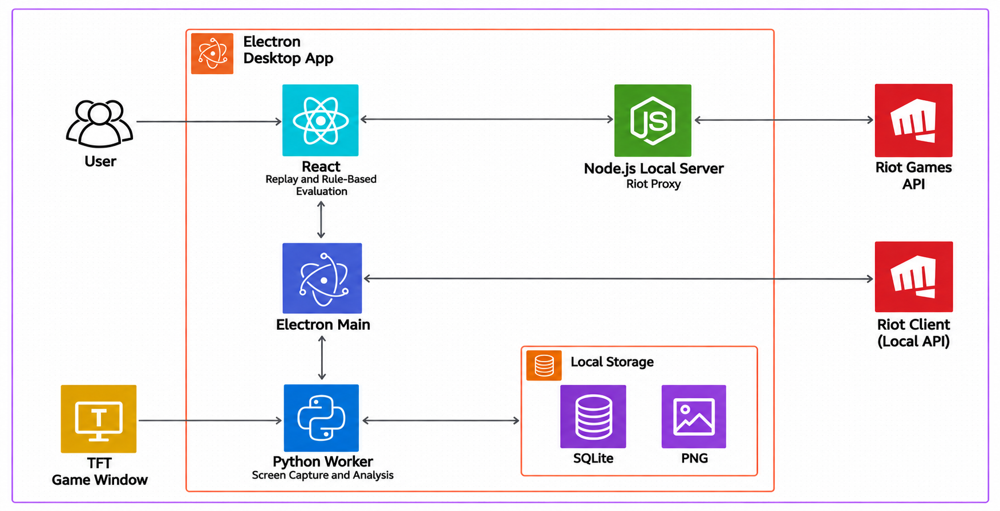
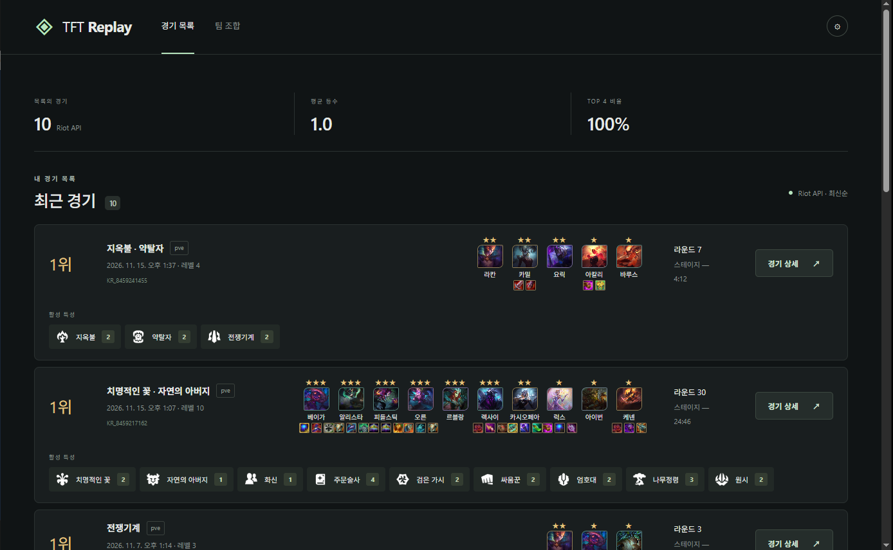
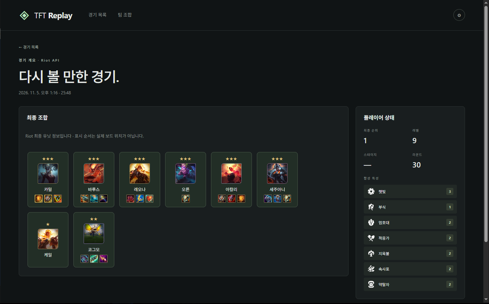
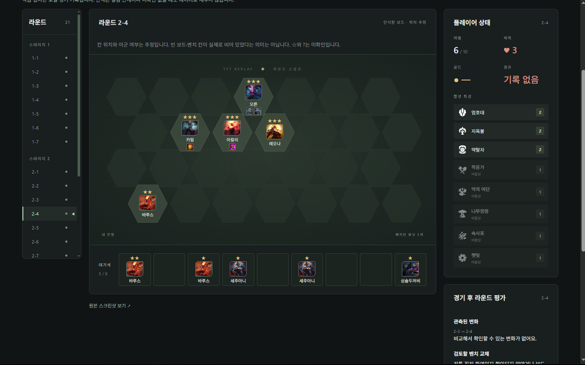
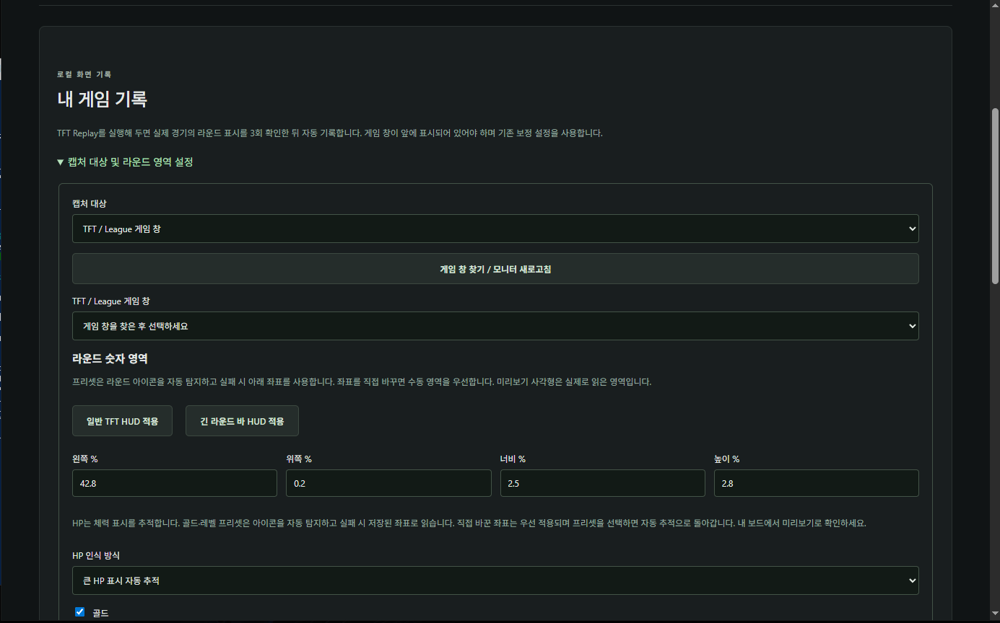
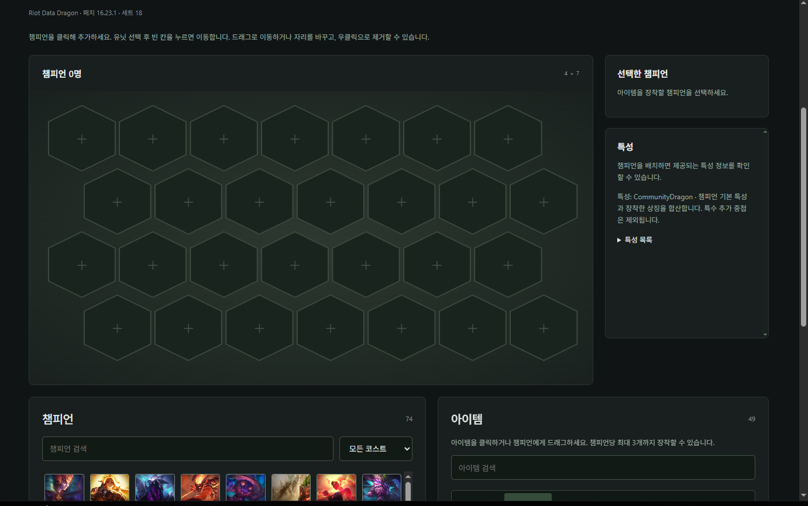
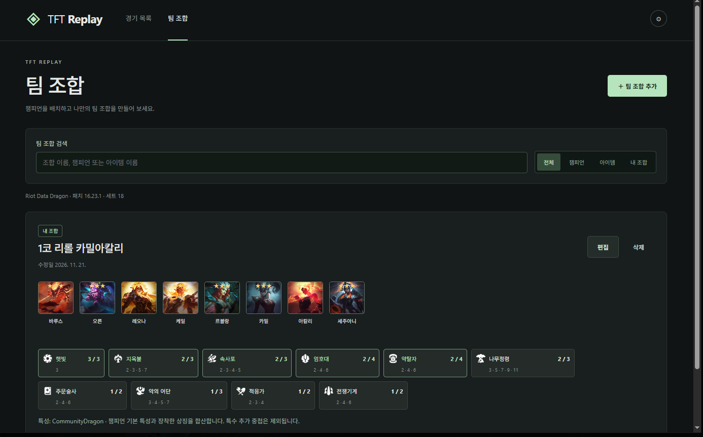

# TFT Replay

**TFT 경기를 라운드별로 기록하고 복기하는 Windows 앱**

## 1. 프로젝트 개요

경기가 끝난 뒤에도 **전투 직전에 어떤 챔피언을 배치했고 대기석에 어떤 선택지가 있었는지** 돌아볼 수 있도록 만들었습니다. TFT 게임 화면을 직접 캡처해 라운드별 보드와 대기석을 복원합니다. 경기 기록과 복기는 사용자 PC에서 처리하며 Riot 전적 API 키가 필요하지 않습니다.

<details>
<summary>실행 및 배포</summary>

프로젝트 루트에서 Node.js 22.12 이상과 Python 3.12 x64로 실행합니다.

```powershell
npm ci
npm run capture:setup
npm start
```

개발 환경에서는 `npm run package`로 Windows 설치 파일을 만듭니다. [캡처 사용법](capture/README.md) · [CI/CD 워크플로](.github/workflows/windows.yml) · [배포 파일](https://github.com/hebi0306/tft-replay/releases)

TFT Replay는 Riot Games의 공식 제품이 아닙니다. [보조 모델 출처](capture/models/champion-identity-SOURCE.md) · [모델 라이선스](capture/models/champion-identity-LICENSE.md)

</details>

## 2. 주요 기능

- **자동 경기 기록** · 게임 창과 라운드를 감지해 전투 직전 준비 화면을 저장합니다.
- **라운드별 복기** · 보드 배치, 대기석, 성급, 아이템, 체력, 골드, 레벨을 확인하고 원본 화면과 비교할 수 있습니다.
- **경기 후 라운드 평가** · 이전 라운드의 변화와, 조건을 만족하는 경우 대기석 교체 후보를 보여줍니다.
- **팀 빌더** · 4×7 육각형 보드에서 조합을 구성하고 저장·검색할 수 있습니다.

## 3. 기술 스택

| 영역 | 기술 |
| --- | --- |
| 데스크톱·화면 | Electron, React, Vite, Node.js |
| 캡처·인식 | Python, MSS, OpenCV, RapidOCR, YOLO11n, ONNX Runtime |
| 로컬 저장 | SQLite, PNG |
| 패키징·CI/CD | PyInstaller, Electron Builder, NSIS, GitHub Actions |

## 4. 시스템 아키텍처


Riot Games API와 Riot Client 로컬 API 연결은 Riot 연동 버전의 구성입니다.

**라운드·체력·골드·레벨**은 HUD 영역을 잘라 OCR로 읽습니다. **유닛 위치**는 YOLO의 탐지 박스를 보드 칸에 매핑해 추정합니다. **챔피언·아이템 종류**는 참조 이미지와 비교하고, 미확인 챔피언에는 TFT Copilot 분류 모델을 보조로 사용합니다.

<details>
<summary>추가 아키텍처 이미지</summary>



</details>

## 5. 실행화면

### 최근 경기 목록 및 경기 상세

Riot API 연동 버전 화면입니다.

| 최근 경기 목록 | 경기 상세 |
| --- | --- |
|  |  |

### 라운드 복기



### 자동 기록 및 캡처 설정



### 팀 빌더 및 저장한 조합

| 팀 조합 만들기 | 저장한 팀 조합 |
| --- | --- |
|  |  |
